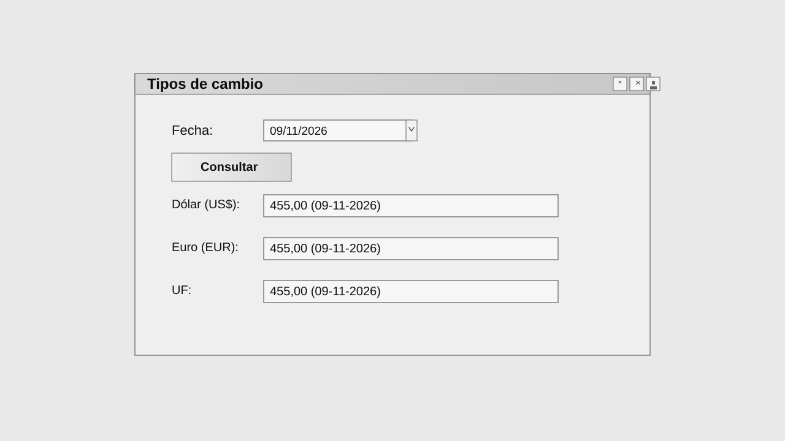

# Mi Primer Addon

<div align="center">
  
</div>

<div align="center">


</div>

Add-on personalizado para SAP Business One, desarrollado con C# y .NET Framework 4.8, orientado a la integración con la UI API y a la consulta de tipos de cambio.

## Tabla de contenidos

- [Overview](#overview)
- [Features](#features)
- [Stack Tecnológico](#stack-tecnológico)
- [Requisitos](#requisitos)
- [Estructura del proyecto](#estructura-del-proyecto)
- [Instalación](#instalación)
- [Guía de uso](#guía-de-uso)
- [Flujo de trabajo](#flujo-de-trabajo)
- [Estado del proyecto](#estado-del-proyecto)
- [Roadmap](#roadmap)
- [Capturas](#capturas)
- [Licencia](#licencia)
- [Autor](#autor)

## Overview

Este proyecto crea un menú dentro de SAP Business One y abre un formulario para consultar valores de cambio de:

- Dólar (USD)
- Euro (EUR)
- UF (Unidad de Fomento)

Se trata de una base funcional para add-ons de SAP B1, con una estructura clara y preparada para crecer con nuevas pantallas, validaciones y servicios.

## Features

| Característica | Descripción |
| --- | --- |
| Menú personalizado | Añade un acceso directo dentro del entorno de SAP Business One |
| Formulario de consulta | Permite introducir una fecha y ver los valores asociados |
| Integración SAP UI API | Usa `SAPbouiCOM` para interactuar con la interfaz |
| Integración SAP DI API | Usa `SAPbobsCOM` para consultar o trabajar con datos empresariales |
| Validación de entrada | Comprueba fechas y evita errores básicos de uso |
| Arquitectura extensible | Sirve como base para futuras pantallas y lógicas |
| Compatibilidad .NET Framework | Diseñado para .NET Framework 4.8 |

## Stack Tecnológico

- C#
- .NET Framework 4.8
- SAP Business One UI API (`SAPbouiCOM`)
- SAP Business One DI API (`SAPbobsCOM`)
- Visual Studio 2022+

## Requisitos

- Windows
- .NET Framework 4.8
- Visual Studio 2022 o superior
- SAP Business One con soporte de add-ons y UI API
- Permisos y configuración del entorno SAP adecuados

## Estructura del proyecto

```text
MiprimerAddon/
├── .gitignore
├── LICENSE
├── README.md
├── assets/
│   ├── banner.svg
│   └── form-preview.svg
├── MiprimerAddon.slnx
├── MiprimerAddon/
│   ├── Addon.cs
│   ├── App.config
│   ├── Form1.cs
│   ├── Form1.Designer.cs
│   ├── Form1.resx
│   ├── MiprimerAddon.csproj
│   ├── Program.cs
│   └── Properties/
└──
```

## Instalación

1. Clona este repositorio.
2. Abre la solución `MiprimerAddon.slnx` en Visual Studio.
3. Compila el proyecto en `Debug` o `Release`.
4. Registra el add-on según la configuración de tu entorno SAP Business One.
5. Ajusta la conexión SAP en la lógica de inicio si corresponde a tu entorno.

## Guía de uso

1. Ejecuta el add-on desde el entorno de SAP Business One.
2. Accede al menú `Mi Primer Addon`.
3. Abre la opción `Abrir formulario`.
4. Introduce la fecha deseada.
5. Pulsa `Consultar` para ver los resultados.

## Flujo de trabajo

```text
Inicio del add-on
   ↓
Registro de menú en SAP Business One
   ↓
Apertura de formulario
   ↓
Entrada de fecha
   ↓
Consulta de valores
   ↓
Visualización de resultados
```

## Estado del proyecto

Este proyecto se encuentra en desarrollo activo y cuenta con una base funcional para consultas de tipo de cambio y extensiones futuras.

## Roadmap

- [ ] Mejorar validaciones y manejo de errores
- [ ] Añadir más monedas o indicadores
- [ ] Mejorar la presentación visual del formulario
- [ ] Modularizar la lógica de negocio
- [ ] Preparar una versión estable para pruebas internas
- [ ] Añadir autenticación o seguridad si el proyecto evoluciona

## Product Preview

Vista previa del panel principal y del formulario de consulta del add-on dentro del entorno SAP Business One.

<div align="center">
  
</div>

La captura representa la experiencia principal del usuario: un panel visual, una consulta rápida por fecha y una salida clara con los valores del dólar, euro y UF.

## Licencia

Este proyecto está licenciado bajo la licencia MIT. Consulta el archivo `LICENSE` para más detalles.

## Autor

Proyecto personal para explorar el desarrollo de add-ons para SAP Business One utilizando C# y .NET Framework.

## Repositorio

- GitHub: https://github.com/waifu3/MiPrimerAdd-on

## Contribuciones

Las contribuciones son bienvenidas. Si quieres mejorar el proyecto, abre un pull request o comparte una idea de funcionalidad.
